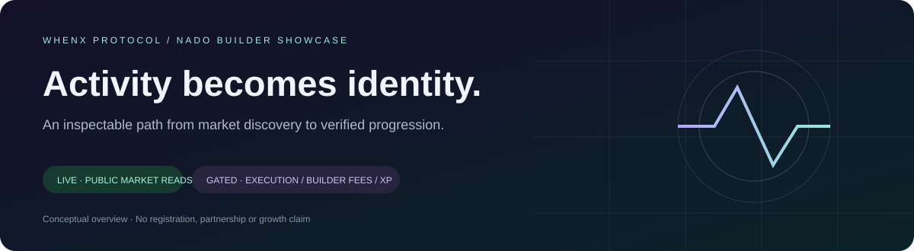
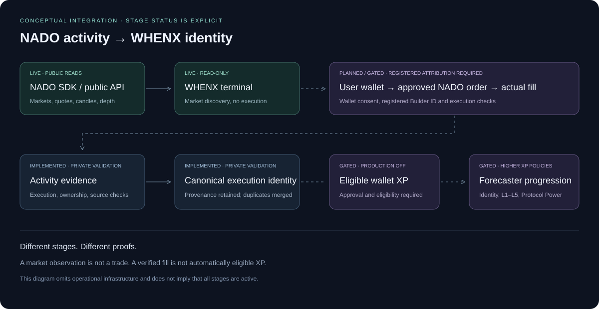
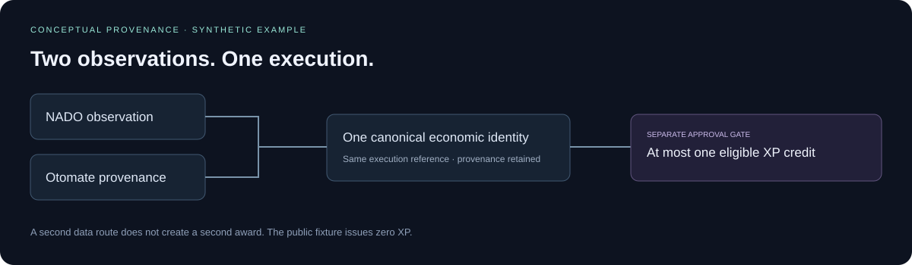
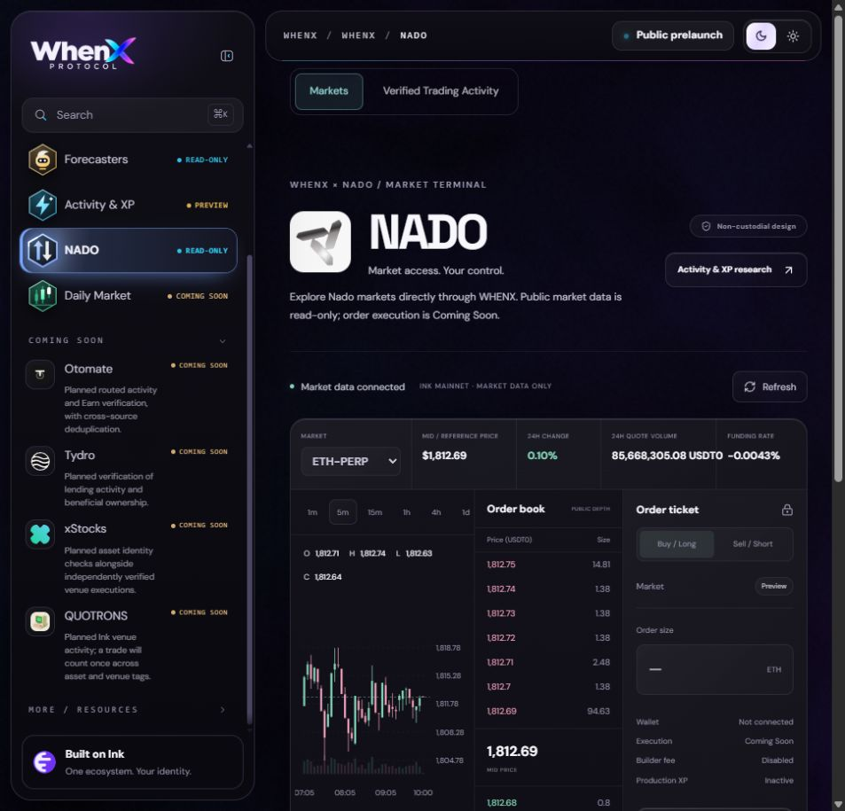
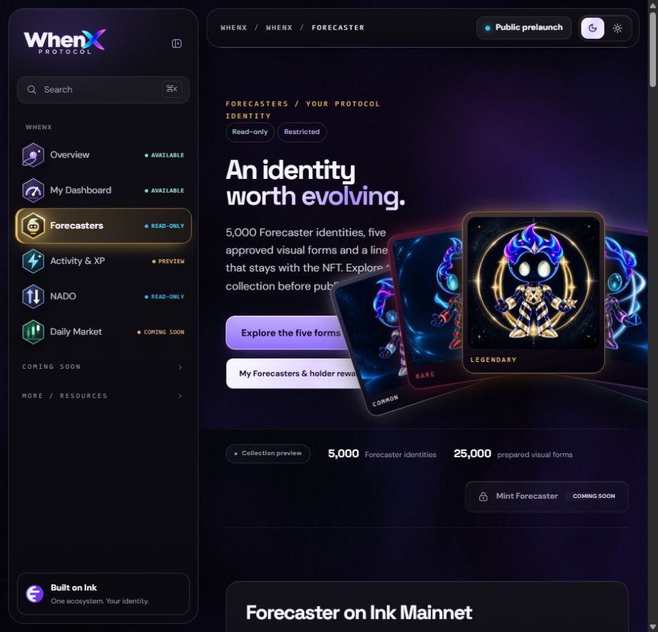
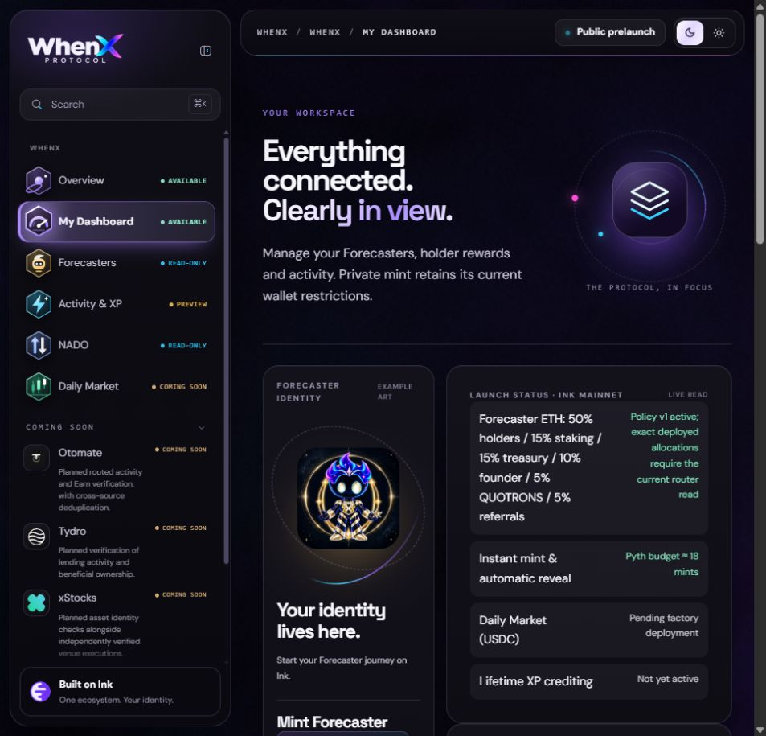
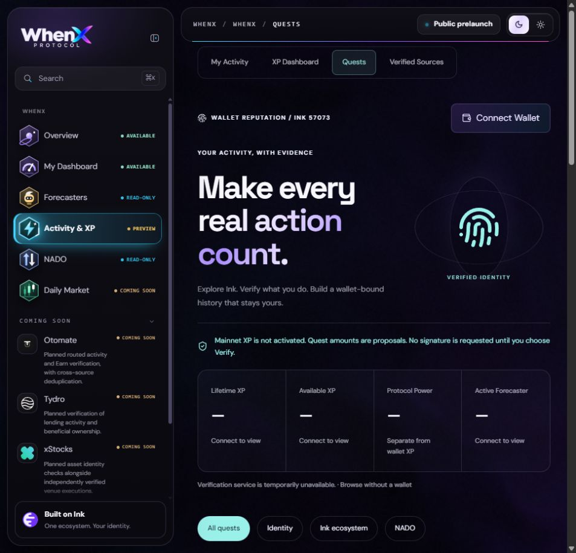
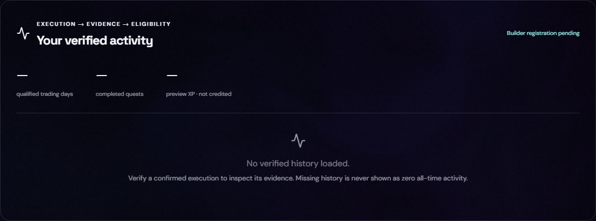
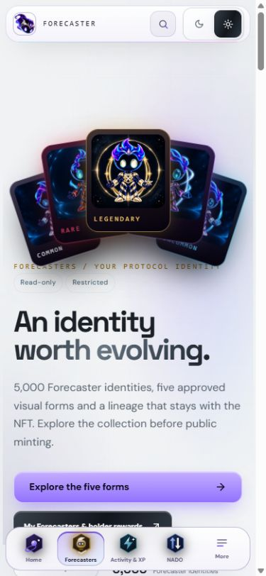

<p align="center"></p>

<h1 align="center">WHENX Protocol × NADO</h1>
<p align="center"><strong>Verified Activity. Evolving Identity. Protocol Participation.</strong></p>
<p align="center">Your wallet shows what you own. WHENX shows what you've done.</p>



WHENX is an onchain identity and activity protocol on **Ink**. Forecaster NFTs carry an evolving visual identity; eligible, verified activity contributes to wallet-linked Lifetime XP. The NADO integration connects public market discovery with a planned path from genuine executions to verifiable progression.

**This is a focused developer showcase and Builder ID application package.** Public market reads are working. Order execution through WHENX, builder fees and production XP are not enabled. No NADO partnership, registration, endorsement, trading volume or user-growth claim is implied.

[Live product](https://whenx.live) · [NADO terminal](https://whenx.live/trade/nado) · [Architecture](docs/architecture.md) · [Developer examples](docs/demo.md) · [Application](application/NADO_BUILDER_APPLICATION.md)

## What is built

| Area | Evidence-backed status, reviewed 19 November 2026 |
|---|---|
| NADO market terminal | **Live, read-only.** Market selection, public candles, depth and funding. |
| Forecaster identities | **Deployed on Ink.** Original 5,000-identity collection and L1–L5 artwork commitments; private mint/reveal previously verified. |
| Reveal automation | **Operational availability under review.** Earlier successful operation is not a promise of current service availability. |
| Activity verification | **Implemented and tested.** Receipt/source/ownership checks and cross-route deduplication remain separate from eligibility. |
| Wallet XP and Quests | **Development Preview.** Public verification service currently unavailable; Mainnet crediting and spending disabled. |
| Higher-level progression | **Gated.** Original identity/rarity persist through the approved Fusion mechanics; higher XP policies require approval. |
| WHENX Builder ID | **Application prepared, not submitted.** No issued WHENX ID or approved fee rate is assumed. |
| Order execution / builder fees | **Not activated.** No trading or financial calls in this repository. |

See [status and limitations](docs/development-status.md) and [evidence scope](docs/evidence.md). Screenshots are actual interface captures, not fabricated trading activity.

## Why NADO

WHENX gives Ink users a dedicated place to discover NADO markets and understand their own eligible activity. Forecaster identity and progression could provide recurring reasons to return, while builder attribution could identify order flow genuinely originating through the interface.

For NADO, the proposal is an additional ecosystem entry point and an inspectable integration. For users, it is convenient market access and a clearer activity history. For WHENX, it is a potential registered source of attribution and builder revenue. These are product benefits we intend to test—not forecasts of trading volume, retention or earnings.

## The integration, without blurred boundaries



**Live today:** public NADO data → read-only WHENX terminal.  
**Implemented privately:** evidence validation → canonical economic identity → duplicate prevention.  
**Gated / planned:** eligible order submission with an assigned Builder ID → approved XP credit → higher Forecaster progression.

Market observations are not executed trades. An indexer record alone is not an authenticated fill. A verified fill is not automatically an eligible XP credit. [Read the verification boundaries →](docs/activity-verification.md)

## One execution. One economic identity.



The same underlying NADO execution may be visible through more than one interface. WHENX retains route provenance without creating another award merely because an Otomate-originated action also appears in NADO data. Our isolated fixture demonstrates deduplication; it deliberately does not publish the production anti-abuse engine or issue XP.

## Real product, clearly labelled

| NADO market terminal — live public reads | Forecaster collection — published artwork preview |
|---|---|
|  |  |

| Dashboard — disconnected public view | Quests — Development Preview, service unavailable |
|---|---|
|  |  |

| Activity — Development Preview, no loaded personal history | Mobile — actual public interface |
|---|---|
|  |  |

Captures are dated and scoped in [the screenshot register](docs/screenshots.md). No personal account is connected. Collection examples are not represented as a user's owned NFT. Market prices are observations at capture time, not current quotes or a demonstration of execution.

## Run the public examples

Node **22.19+**. No credentials or wallet required.

```sh
npm ci
npm test
npm run markets
npm run appendix
npm run demo
```

- `markets`: real public queries through the official `@nadohq/engine-client` package. It contacts NADO directly, never the WHENX backend.
- `appendix`: offline encoding with official SDK utilities. Configuration remains `WHENX_BUILDER_ID` / `WHENX_BUILDER_FEE_RATE`; no order is constructed or sent.
- `demo`: local conceptual journey with explicitly synthetic executions, duplicate detection and **zero XP issued**.

Examples are independent demonstration code. They do not contain a production verifier, signer, account connector or order submission service. [Exact commands and expected behavior →](docs/demo.md)

## Builder registration request

We would like NADO to evaluate WHENX for a registered Builder ID and confirm the current integration requirements, permitted attribution, fee bounds, quote/custody conventions and registration process. We will not borrow another interface's attribution or invent a fee rate.

[Builder integration proposal](docs/builder-integration.md) · [Application package](application/NADO_BUILDER_APPLICATION.md) · [Draft outreach](application/NADO_OUTREACH_MESSAGE.md)

The application is prepared, not submitted. Registration and any financial activation require separate confirmation.

## Developer documentation

- [Architecture and trust boundaries](docs/architecture.md)
- [Activity verification and provenance](docs/activity-verification.md)
- [Builder appendix and registration](docs/builder-integration.md)
- [Current status and open work](docs/development-status.md)
- [Evidence and public references](docs/evidence.md)
- [Security and disclosure scope](SECURITY.md)

## Contact and licensing

Approved public project destination: **[whenx.live](https://whenx.live)**. No personal contact or unapproved social profile is included. Project communication details can be supplied through the official application process after approval.

New demonstration code is MIT licensed. WHENX names, logos, original NFT artwork and product screenshots are excluded from that code licence; their inclusion does not grant a right to reuse or mint the collection. See [LICENSE](LICENSE) and [asset rights](assets/LICENSE.md).
