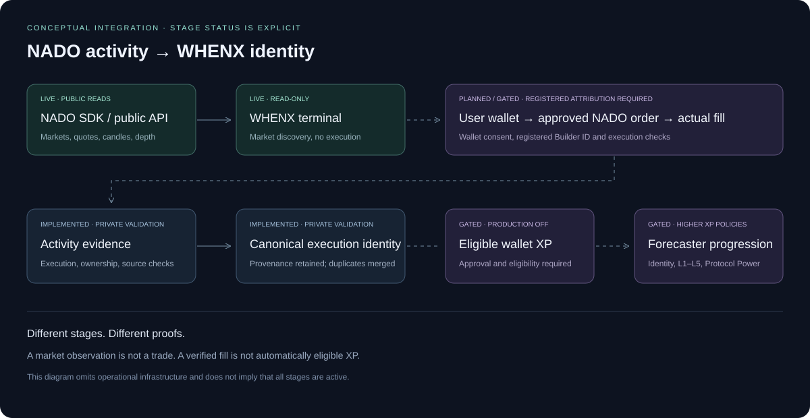

# Architecture

The product has two distinct paths. The public terminal reads NADO market data without a wallet. A future enabled order path will require the user's own wallet approval and an officially registered builder configuration.

| Stage | Responsibility | Current boundary |
|---|---|---|
| Wallet | User-controlled identity and consent | No wallet connection in this showcase |
| Terminal | Discover markets and inspect candles/depth | Public read-only product |
| NADO SDK / API | Public market queries; future attributed orders | Showcase uses queries only |
| Execution evidence | Authenticate the underlying economic action | Product implementation; not an indexer-only assumption |
| Activity Network | Bind ownership, retain provenance, avoid duplicates | Private implementation; public fixture illustrates the concept |
| Wallet XP | Apply the exact approved eligibility policy | Production crediting/spending disabled |
| Forecaster progression | Connect eligible wallet progression to NFT mechanics | Higher XP policies and public mint remain gated |

An API response can describe a trade without proving a user's entitlement. The interface, evidence layer, eligibility policy and onchain credit are separate trust boundaries. Operational infrastructure and security-sensitive validation details are intentionally absent from this repository.

## Identity and progression

Forecasters use the original 5,000-identity artwork universe, five visual forms and committed rarity. Lifetime XP belongs to the wallet identity; NFT ownership transfers do not move that history. Protocol Power is a separate NFT property, not a relabelled XP balance. Fusion replaces burned inputs with a successor preserving the approved core identity and rarity. Higher-level XP policies are not publicly activated.
